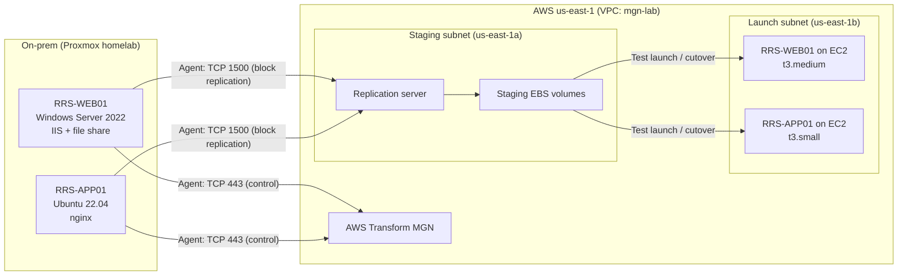

# Server Migration to AWS with AWS Transform MGN

Lift-and-shift migration of two on-premises servers (Windows Server 2022 and Ubuntu 22.04) from a Proxmox homelab to Amazon EC2, using AWS Transform MGN (formerly AWS Application Migration Service). Includes a pre-migration assessment, a test launch, a cutover with a data-loss check, and a sizing decision based on measured usage instead of the tool's defaults.

## The business problem

Red River Supply, a small distributor (fictional), runs two servers in a closet:

| Server | OS | Role |
|---|---|---|
| RRS-WEB01 | Windows Server 2022 | Company intranet site (IIS) and file share |
| RRS-APP01 | Ubuntu Server 22.04 LTS | Internal web tool (nginx) |

The hardware is out of warranty. Leadership wants both servers moved to AWS with minimal downtime, no lost data, and no paying for capacity the servers don't use.

## Architecture

An agent on each source server copies disk blocks to a replication server in AWS and keeps the copy in sync as the servers keep running. At launch, MGN converts the copied disks so they boot on EC2 and builds the instances from launch templates.

## How the migration ran

### 1. Pre-migration assessment

Each server was built with deliberately generous resources, then measured from inside the operating system before any migration tooling was installed.

| Server | Allocated | Disk used | CPU used | RAM used |
|---|---|---|---|---|
| RRS-WEB01 | 4 vCPU / 8 GiB | 19.6 GB | 5.5% | 1.3 GiB |
| RRS-APP01 | 2 vCPU / 4 GiB | 11 GB | 0.5% | ~2 GiB |

RAM was taken from inside the guest, not from the hypervisor. Proxmox reports what it handed the VM, not what the OS uses. On Linux, "used" was calculated as total minus *available*, since Linux counts disk cache as used memory.

### 2. AWS landing zone and replication

- Created a dedicated VPC (`mgn-lab`) with a staging subnet for replication and a separate launch subnet for the migrated servers.
- Configured the MGN replication template: staging subnet, encrypted EBS, MGN-managed security group, public-IP replication (no VPN), and a `Project = mgn-lab` tag on every replication resource.
- Installed the replication agent on both servers. Initial sync of both servers took about **30 minutes**.

### 3. Launch settings

- Turned off MGN's automatic instance sizing and set instance types from the assessment (see [Sizing decision](#sizing-decision)).
- Edited each EC2 launch template for the launch subnet, a public IP, and a security group that allows RDP, SSH, and HTTP **from my IP only**.
- Set each new launch template version as the **default**. MGN launches from the default version, and editing a template creates a new version without making it the default.

### 4. Test launch

Launched test instances from the replicated data while the source servers kept running:

- Both sites loaded from their EC2 public IPs.
- RDP to the Windows server worked with its existing local account.
- All 25 files in the company file share were present.

Test instances were then terminated and both servers marked ready for cutover.

### 5. Cutover with a data-loss check

1. Wrote a `cutover-marker.txt` file with the current time (9:24 PM) on both source servers, seconds before cutover.
2. Confirmed replication was healthy with no backlog.
3. Launched cutover instances.
4. **Both marker files were present on the migrated EC2 servers**, so data written immediately before cutover made it across.
5. Shut down (did not delete) the source VMs to prevent writes to the old servers.
6. Finalized cutover. MGN stopped replication and removed the replication server and staging volumes.

## Sizing decision

MGN's default sizing matched each server's **allocation**, not its usage.

| Server | MGN default pick | My pick | Reasoning |
|---|---|---|---|
| RRS-WEB01 | c5.xlarge (4 vCPU / 8 GiB) | **t3.medium** (2 vCPU / 4 GiB) | Uses ~0.2 vCPU and 1.3 GiB. Low, spiky load fits a burstable instance. |
| RRS-APP01 | c5.large (2 vCPU / 4 GiB) | **t3.small** (2 vCPU / 2 GiB) | CPU near zero. Memory reading included the migration agent's overhead. |

In total, MGN's picks would have run 6 vCPU / 12 GiB. The assessment-based picks run 4 vCPU / 6 GiB on cheaper burstable instances. For the Windows server, fewer vCPUs also lowers license-included cost, which is billed per vCPU.

These sizes came from a short sample before migration. The next step would be to validate them with CloudWatch over time, including the CloudWatch agent for memory, before committing.

## Problems I hit and how I solved them

**Unsupported OS.** The Linux agent failed with "Your Linux kernel version is not supported." The VM was running Ubuntu 26.04 (kernel 7.0), and MGN supports Ubuntu up to 24.04. I rebuilt the server on Ubuntu 22.04 using the standard install option (kernel 5.15) instead of the newer hardware-enablement kernel. I rejected installing a mainline kernel, since those are unsigned and unsupported for servers. *Lesson: check every server's OS and kernel against the migration tool's support list during assessment, not on migration day.*

**AccessDenied when assuming the installer role.** The first attempt to get installer credentials failed on `sts:AssumeRole`. My user already had admin rights, so the problem was the role's trust policy. I rewrote it to name my IAM user directly as the trusted principal.

**Instance type kept getting overwritten.** MGN's right-sizing setting replaces the launch template's instance type, so it had to be turned off before setting my own types.

## Security decisions

- **No long-lived admin keys.** Agent install used a dedicated `mgn-agent-installer` role with only `AWSApplicationMigrationAgentInstallationPolicy`, assumed for **one-hour temporary credentials**. Each agent receives its own credentials from MGN after registering, so nothing permanent was left behind.
- **Credentials kept out of shell history** during install.
- **Management ports limited to my IP.** RDP, SSH, and HTTP on the migrated servers were never open to the internet.
- **The domain controller was not migrated.** Cloning a domain controller's disk risks Active Directory replication damage (USN rollback). The real-world approach is to build a new DC in AWS and promote it. The migrated Windows server was kept in a workgroup, since no DC is reachable in AWS without a VPN.

## Cost control and teardown

- Billing starts when the first agent connects (replication server and staging volumes), so testing and cutover were done the same evening.
- Every MGN-created resource was tagged `Project = mgn-lab` to make cleanup verifiable.
- Everything was torn down afterward: EC2 instances, volumes, snapshots, launch templates, MGN source servers (disconnected and archived), the VPC, and the installer role.

## What I'd do next

- Validate sizing with CloudWatch metrics and the CloudWatch agent for memory, then resize if needed.
- Replace public RDP/SSH with Systems Manager Session Manager and move the servers into private subnets.
- Add AWS Backup for the migrated instances.
- Cut DNS over to the new servers as part of the cutover runbook.

## Tools and services

AWS Transform MGN, Amazon EC2, Amazon EBS, Amazon VPC, IAM (roles, trust policies, STS temporary credentials), AWS CloudShell, Proxmox VE, Windows Server 2022 (IIS, SMB), Ubuntu Server 22.04 (nginx).
